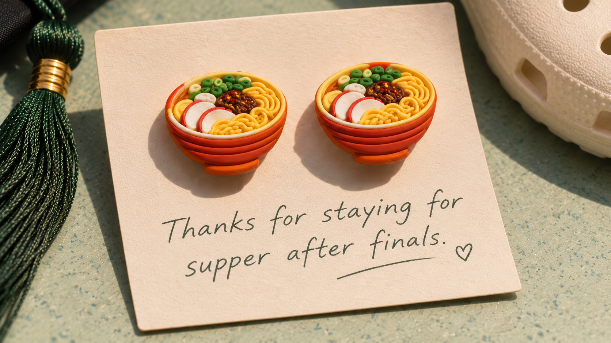
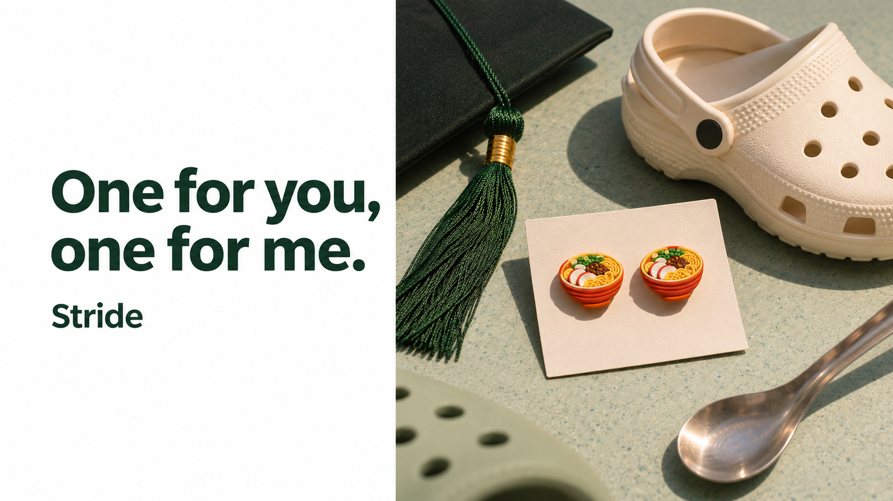
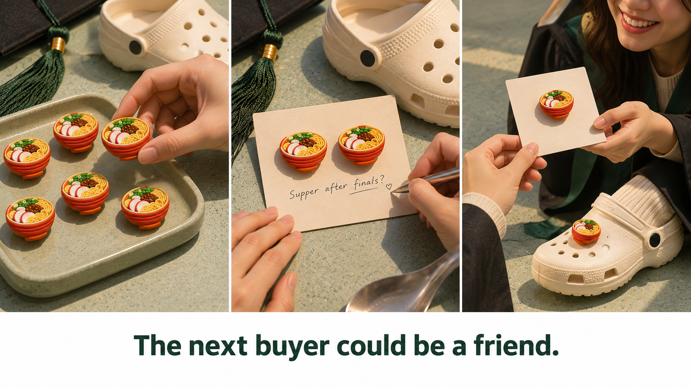
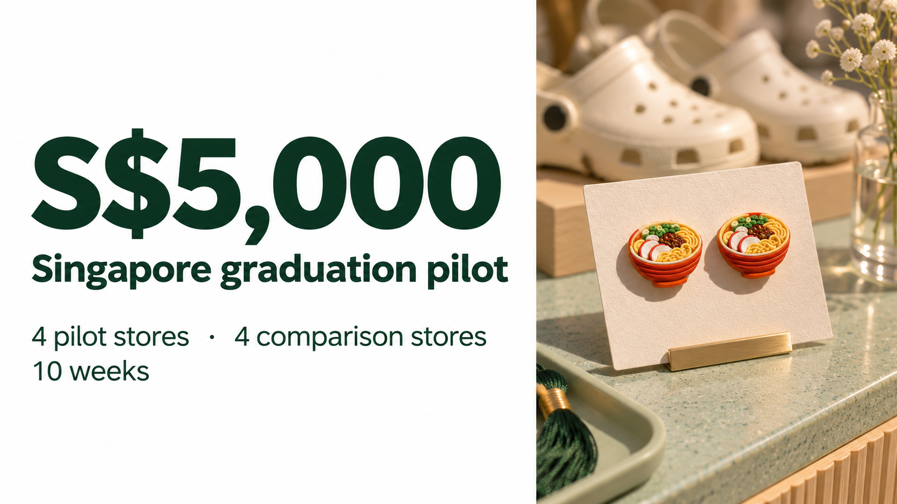
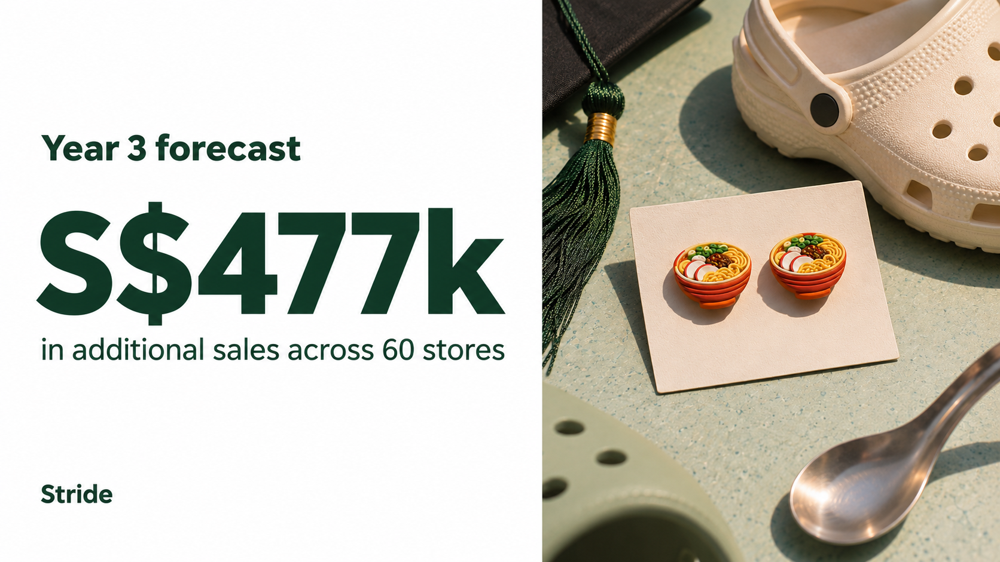

# Stride — One for you, one for me

Entry for **The Next Expression 2027 Competition**. Stride proposes turning Crocs personalization into a gifting experience: choose two meaningful Jibbitz, write a personal note, and give one to a friend.

## The pitch

Imagine receiving this as a graduation gift. The note turns a pair of tiny charms into a reminder of a moment you shared with a friend.

Two noodle bowls mean something because you know exactly which supper your friend remembers. Stride makes that shared memory the reason to choose a charm: one to give, one to keep.

At a Crocs store, shoppers pick two Jibbitz that remind them of a friend and write a personal note. Gifting gives even someone who has never owned Crocs a reason to buy.

We propose testing graduation gifting in Singapore before expanding. Comparing pilot stores with similar stores will help assess whether the experience generates additional charm sales.

If the Singapore pilot works, the next test would adapt the experience for birthdays in South Korea. This would test whether the idea can extend to another occasion and market.

The year-three forecast is nearly half a million Singapore dollars in additional sales. This depends on the assumptions in the [financial model](./Financial_Model.xlsx) and validation through the pilot.

## Project files

| File | Purpose |
| --- | --- |
| [Video_Pitch.mp4](./Video_Pitch.mp4) | Video pitch |
| [Pitch_Deck.pdf](./Pitch_Deck.pdf) | PDF deck for viewing |
| [Financial_Model.xlsx](./Financial_Model.xlsx) | Financial model and assumptions |
| [Research_and_Sources.md](./Research_and_Sources.md) | Supporting research and sources |
| [Video_Script.md](./Video_Script.md) | Voiceover script |
| [video-source](./video-source/) | Editable Remotion project, images, and approved audio |

## Competition challenge

Imagine you are the General Manager of Personalization in Asia Pacific for Crocs. Reimagine and grow the business over the next three years to engage the next generation of consumers and drive revenue growth.

- **Define:** What should personalization mean for the next generation of consumers?
- **Design:** What business model and consumer experience should Crocs build?
- **Deliver:** How will the proposal drive engagement and revenue while remaining practical to execute?

The approach may draw on consumer, brand, retail, digital, product, operations, or other relevant levers.

## About the competition

The Next Expression is a Crocs university business case competition for students in **China, Japan, and Singapore**, focused on personalization in Asia Pacific.

## Required submission

- **Video:** an English pitch of no more than **one minute**.
- **Deck:** a PowerPoint presentation of no more than **10 slides**.
- Cover an executive summary; business and consumer insights; recommended strategy; estimated financial impact, resources and key assumptions; implementation roadmap and KPIs; and supporting research with appropriately cited sources.
